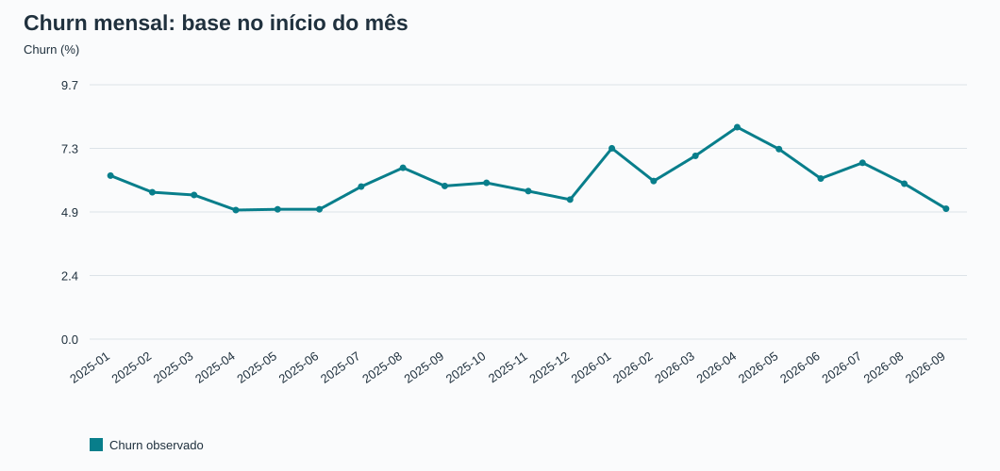
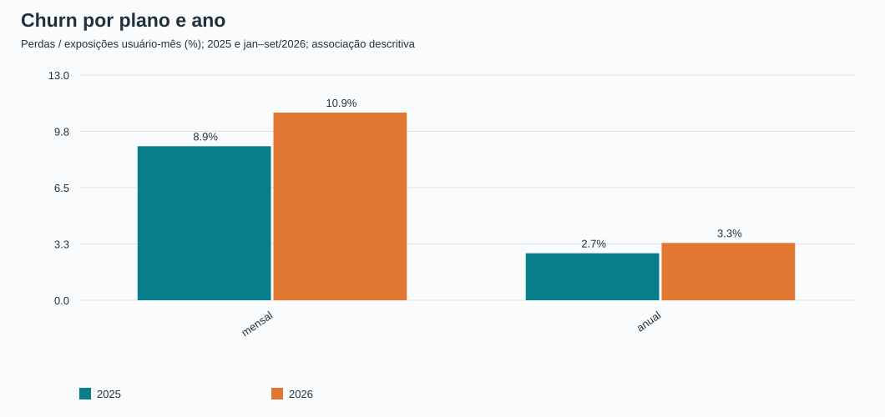
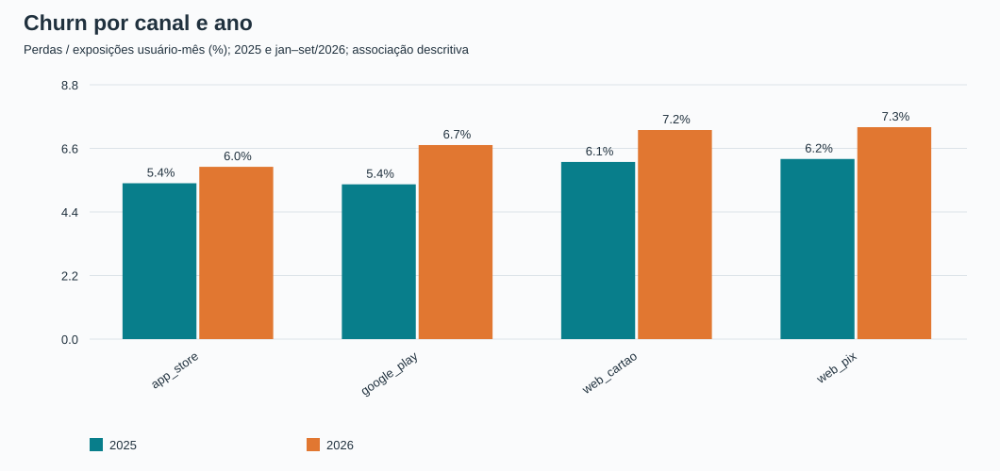
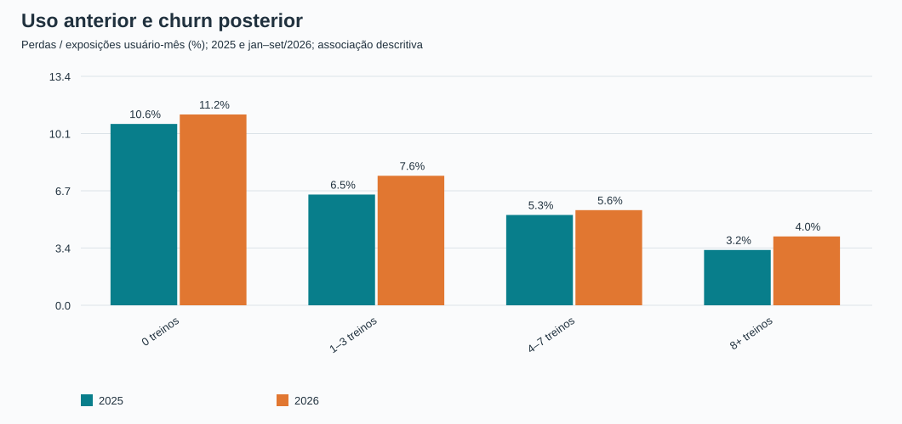

# Preparação dos dados e diagnóstico — John | Semana 5

Status: análise descritiva reproduzível; revisão do grupo pendente. Corte: 30/09/2026, em Brasília.
Responsabilidade: integração, indicadores e hipóteses. Clusterização, personas e decisão financeira final pertencem às demais frentes.

## Pergunta de negócio e entregáveis

Como uso e churn variam por plano, canal e período, e quais hipóteses os dados sustentam para investigar a alta de 2026?
Período histórico: janeiro/2025 a setembro/2026. População da segmentação: pagantes ativos ao final do corte, incluindo quem desligou a renovação mas ainda tem período pago.

As bases individuais estão em `dados/processados/s5_john/`, fora do Git. Os CSVs agregados e gráficos desta pasta podem ser compartilhados com o grupo. O código está em `src/preparar_diagnostico_s5.py`.

## Método e decisões

- As 60 contas internas são identificadas pelo domínio de e-mail normalizado e excluídas das populações pagantes.
- O histórico é reconstruído com inícios e expirações dos eventos. Somente assinaturas anteriores a 01/07/2024 usam a data de início do retrato como semente. Nesta base há uma assinatura por conta e plano/canal não mudam nos eventos; essas condições são verificadas em código.
- Ativo em uma data significa início ≤ data e fim > data, ou sem fim. Desligar renovação e entrar em carência não encerram o período pago. Expiração já acompanha reembolso/chargeback; esses avisos não são contados novamente como perdas.
- Churn mensal = assinantes ativos no início do mês que expiram durante o mês / ativos no início do mês. Quem começou e terminou no mesmo mês não pertence a esse denominador.
- Datas com `Z` são convertidas de UTC para Brasília; Garmin recebe correção de −3h. O limite de tempo é exclusivo em 01/10/2026 00h.
- Uso para comparar com churn é do mês anterior; a análise principal de uso inclui apenas quem já era pagante no início daquele mês anterior. Janeiro/2025 fica sem uso anterior porque dezembro/2024 não foi fornecido.
- Ausência de linha de treino em 2025 vira zero somente dentro da cobertura conhecida e com população definida. Sessões do app não são reconstruídas nos meses sem treino de 2025.
- A atividade detalhada é padronizada, corrigida de fuso e deduplicada. Duração inválida fica sinalizada e sai dos agregados de treino válido; distância incompatível fica nula e não entra no agrupamento.
- As referências a companhia de treino em branco são ausência opcional, não referências a contas inexistentes. Datas posteriores ao corte em posts e relações sociais são excluídas; resoluções futuras não tornam um ticket resolvido no passado.
- Textos e imagens não recebem interpretação generativa nesta etapa. Contagens de posts, seguidores e tickets são usadas como sinais observados. Não há chamadas pagas de IA.

## Base no corte

| plano | canal_cobranca | assinantes | mediana_treinos_30d | media_treinos_30d | sem_treino_30d_pct | renovacao_desligada_retrato | receita_mensal_equivalente_proxy |
|---|---|---|---|---|---|---|---|
| anual | app_store | 3047 | 7,00 | 8,42 | 17,72 | 671 | 74.184,61 |
| anual | google_play | 2928 | 6,00 | 7,75 | 20,63 | 771 | 71.500,60 |
| anual | web_cartao | 1803 | 6,00 | 7,82 | 21,41 | 465 | 44.049,97 |
| anual | web_pix | 700 | 7,00 | 8,13 | 18,86 | 175 | 17.174,17 |
| mensal | app_store | 2348 | 10,00 | 11,27 | 0,55 | 65 | 93.685,20 |
| mensal | google_play | 2036 | 10,00 | 11,29 | 0,64 | 46 | 81.236,40 |
| mensal | web_cartao | 1191 | 10,00 | 11,34 | 0,84 | 36 | 47.520,90 |
| mensal | web_pix | 700 | 10,00 | 11,25 | 0,57 | 21 | 27.930,00 |

Há 14753 pagantes ativos. A base individual preserva `user_id`, mas exclui e-mail, data de nascimento, localização e textos integrais. O arquivo de clusterização não inclui desfecho futuro, intenção de cancelamento nem valor financeiro; Leonardo deve escolher variáveis, tratar ausências e padronizar escalas antes de ajustar os grupos.

## Evolução do churn

| ano | expostos | perdas | churn_pct | media_mensal_simples_pct |
|---|---|---|---|---|
| 2025 | 134481 | 7559 | 5,62 | 5,62 |
| 2026 | 125847 | 8320 | 6,61 | 6,62 |

`churn_pct` na tabela acima divide o total de perdas pelo total de exposições usuário-mês; `media_mensal_simples_pct` dá o mesmo peso a cada mês e é a referência mais próxima à média mensal do enunciado. Exposições não são pessoas distintas. Os períodos completos disponíveis têm durações diferentes.

Comparação com meses equivalentes (jan–set nos dois anos):

| ano | expostos | perdas | churn_pct |
|---|---|---|---|
| 2025 | 96274 | 5399 | 5,61 |
| 2026 | 125847 | 8320 | 6,61 |

Decomposição aritmética por plano, usando janeiro–setembro nos dois anos:

| plano | participacao_exposicoes_2025_pct | participacao_exposicoes_2026_pct | churn_2025_pct | churn_2026_pct | componente_taxas_pp | componente_composicao_pp |
|---|---|---|---|---|---|---|
| anual | 52,83 | 56,37 | 2,45 | 3,32 | 0,47 | 0,10 |
| mensal | 47,17 | 43,63 | 9,14 | 10,86 | 0,78 | -0,35 |

O componente de taxas usa a participação média de cada plano nos dois períodos multiplicada pela mudança de sua taxa. O componente de composição usa a taxa média multiplicada pela mudança de participação. A soma fecha exatamente com a mudança agregada, mas não identifica causas. A migração da composição para o anual amortece parte da piora dentro dos planos.

Série mensal completa:

| mes | expostos | perdas | churn_pct |
|---|---|---|---|
| 2025-01 | 8540 | 534 | 6,25 |
| 2025-02 | 9418 | 529 | 5,62 |
| 2025-03 | 10014 | 552 | 5,51 |
| 2025-04 | 10577 | 522 | 4,94 |
| 2025-05 | 10937 | 543 | 4,96 |
| 2025-06 | 11317 | 562 | 4,97 |
| 2025-07 | 11640 | 679 | 5,83 |
| 2025-08 | 11811 | 774 | 6,55 |
| 2025-09 | 12020 | 704 | 5,86 |
| 2025-10 | 12413 | 742 | 5,98 |
| 2025-11 | 12771 | 723 | 5,66 |
| 2025-12 | 13023 | 695 | 5,34 |
| 2026-01 | 13140 | 959 | 7,30 |
| 2026-02 | 13728 | 830 | 6,05 |
| 2026-03 | 14111 | 989 | 7,01 |
| 2026-04 | 14237 | 1154 | 8,11 |
| 2026-05 | 14119 | 1026 | 7,27 |
| 2026-06 | 14102 | 866 | 6,14 |
| 2026-07 | 14059 | 948 | 6,74 |
| 2026-08 | 14032 | 834 | 5,94 |
| 2026-09 | 14319 | 714 | 4,99 |

## Diferenças por plano e canal

| ano | plano | expostos | perdas | churn_pct |
|---|---|---|---|---|
| 2025 | anual | 71532 | 1946 | 2,72 |
| 2025 | mensal | 62949 | 5613 | 8,92 |
| 2026 | anual | 70936 | 2354 | 3,32 |
| 2026 | mensal | 54911 | 5966 | 10,86 |

| ano | canal_cobranca | expostos | perdas | churn_pct |
|---|---|---|---|---|
| 2025 | app_store | 45688 | 2463 | 5,39 |
| 2025 | google_play | 46289 | 2478 | 5,35 |
| 2025 | web_cartao | 29053 | 1780 | 6,13 |
| 2025 | web_pix | 13451 | 838 | 6,23 |
| 2026 | app_store | 44822 | 2671 | 5,96 |
| 2026 | google_play | 42837 | 2875 | 6,71 |
| 2026 | web_cartao | 25787 | 1865 | 7,23 |
| 2026 | web_pix | 12401 | 909 | 7,33 |

As taxas são descritivas. O anual só expira no fim do ciclo, enquanto o mensal renova todos os meses. Comparar taxas sem olhar quem estava elegível à renovação mistura ritmos contratuais com preferência do cliente. Plano, canal, tempo de casa e perfil de uso também podem estar associados entre si.

## Uso anterior e saída posterior

| ano | faixa_uso_anterior | expostos | perdas | churn_pct |
|---|---|---|---|---|
| 2025 | 0 treinos | 16380 | 1741 | 10,63 |
| 2025 | 1–3 treinos | 36230 | 2351 | 6,49 |
| 2025 | 4–7 treinos | 22159 | 1173 | 5,29 |
| 2025 | 8+ treinos | 39825 | 1291 | 3,24 |
| 2026 | 0 treinos | 19207 | 2148 | 11,18 |
| 2026 | 1–3 treinos | 36135 | 2743 | 7,59 |
| 2026 | 4–7 treinos | 22522 | 1256 | 5,58 |
| 2026 | 8+ treinos | 38386 | 1549 | 4,04 |

Uso baixo pode antecipar a saída, mas também refletir problemas de produto, motivação, saúde ou diferenças de perfil. A tabela não prova que aumentar treinos causa retenção. O BI mensal e os eventos de treino detalhados não são intercambiáveis: 6716 linhas de setembro apresentam contagem diferente após deduplicação. Por isso os indicadores mantêm sufixos que identificam sua fonte.

## Reajuste: comparação exploratória

| periodo | plano | expostos | perdas | churn_pct |
|---|---|---|---|---|
| 2025 | anual | 71532 | 1946 | 2,72 |
| 2025 | mensal | 62949 | 5613 | 8,92 |
| 2026 jan–fev | anual | 14550 | 549 | 3,77 |
| 2026 jan–fev | mensal | 12318 | 1240 | 10,07 |
| 2026 mai–set | anual | 40951 | 1318 | 3,22 |
| 2026 mai–set | mensal | 29680 | 3070 | 10,34 |
| 2026 mar–abr | anual | 15435 | 487 | 3,16 |
| 2026 mar–abr | mensal | 12913 | 1656 | 12,82 |

O preço mensal mudou em março/2026. Comparar janeiro–fevereiro com março–abril e maio–setembro permite localizar a mudança, mas não isola seu efeito. São grupos e meses diferentes, sem controle de sazonalidade e composição; não há conclusão causal nem estimativa de impacto do reajuste.

## Motivos declarados e suporte

| motivo_principal | respostas | pct_respostas |
|---|---|---|
| nao_uso | 81 | 12,60 |
| outro | 223 | 34,68 |
| outro_app | 34 | 5,29 |
| preco | 264 | 41,06 |
| problema_tecnico | 27 | 4,20 |
| saude | 14 | 2,18 |

A pesquisa só alcança cancelamentos pelo site e é opcional. As porcentagens acima descrevem respostas, não toda a base nem todas as perdas. Algumas respostas antecedem o fim do período pago e duas contas podem ter mais de uma resposta. O CSV `fins_por_motivo_mes.csv` usa todos os fins por data, incluindo assinaturas iniciadas no próprio mês; seu total não é o numerador do churn. `tickets_por_mes_categoria.csv` permite investigar a hipótese técnica, com cobertura apenas desde julho/2025.

## Limitações e próximos passos

1. Ainda não há clusters: a base preparada é a entrada para o trabalho de Leonardo. Churn por cluster exigirá aplicar a mesma segmentação a observações históricas compatíveis; não atribuir o churn dos que saíram aos grupos formados apenas por sobreviventes do corte.
2. Risco individual de saída até 29/11/2026 não é observado no corte e não é inferido aqui. Intenção de cancelar e expiração são conceitos distintos.
3. A última cobrança aprovada dividida por 12 no anual é somente uma aproximação mensal descritiva. Não representa receita contábil, caixa do mês, LTV ou retorno de intervenção. Faltam estornos/chargebacks líquidos e regras de reconhecimento para essas contas.
4. A base de uso atual contém pessoas com pouco tempo de assinatura: comparar janelas fixas sem considerar tempo de exposição favorece antigos. `tempo_assinatura_dias` está disponível para controle.
5. A versão do app é a última vista no cadastro. Não foi usada como se fosse a versão instalada em abril/2026. A mudança de idioma dos treinos é um sinal de registro, não prova de falha técnica.
6. A análise da campanha sorteada, uplift, mensagens e ROI ficam para a etapa apropriada. Não foi estimado benefício de contato.
7. Qualidade foi medida antes das conclusões. Completude por coluna e auditoria detalhada ficam em arquivos locais; alertas agregados e filtros estão nesta pasta. Campo vazio pode ser opcional: a auditoria não transforma todo vazio em erro.
8. A situação de renovação apresenta cinco divergências conhecidas entre eventos ordenados pelo horário de recebimento e retrato. Em 1.112 pagantes, os eventos relevantes não fornecem o estado inicial da renovação. Os campos ficam separados, com ausências e sinalização; nenhum deles entra nas variáveis candidatas de clusterização.
9. As 6.716 linhas divergentes entre BI e detalhe de setembro não são automaticamente 6.716 erros: as fontes podem usar regras distintas. A diferença não foi atribuída apenas às cópias. A tendência recomendada para clusterização compara duas janelas iguais de 30 dias da atividade tratada; a tendência do BI permanece apenas para auditoria.

## Reprodução e evidências

Na raiz do repositório: `.venv/bin/python src/preparar_diagnostico_s5.py`.
Fontes: `docs/enunciado.md`, `docs/dicionario_dados.md`, `decisoes.md` e 11 arquivos utilizados do data room (campanha e imagens não processadas).
Validação: âncoras oficiais, fechamento por plano e canal, três assinantes ativos e três expirações confrontados com retrato, testes de regras temporais e hashes dos arquivos brutos antes/depois. O manifesto local registra as verificações e as contagens.
